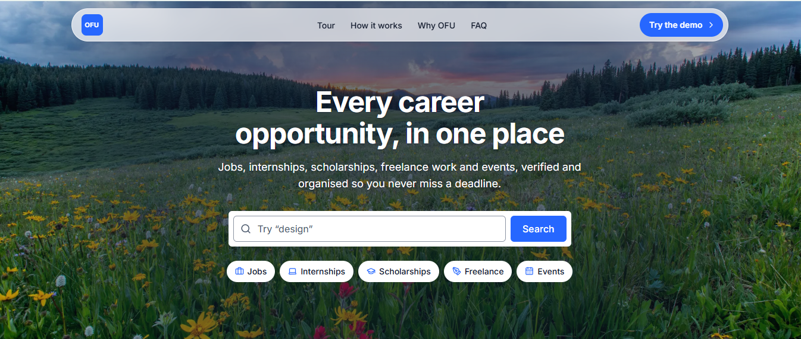
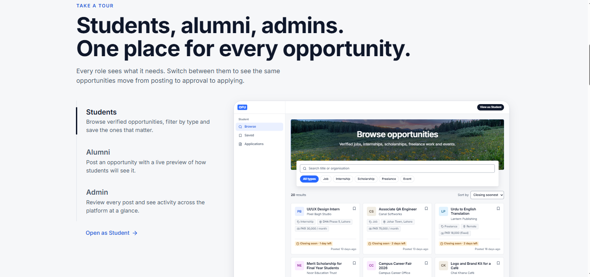
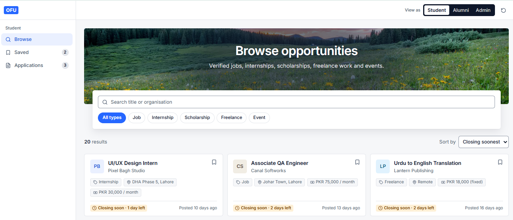
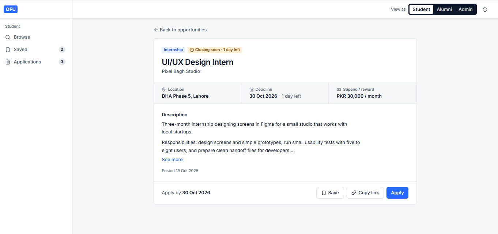
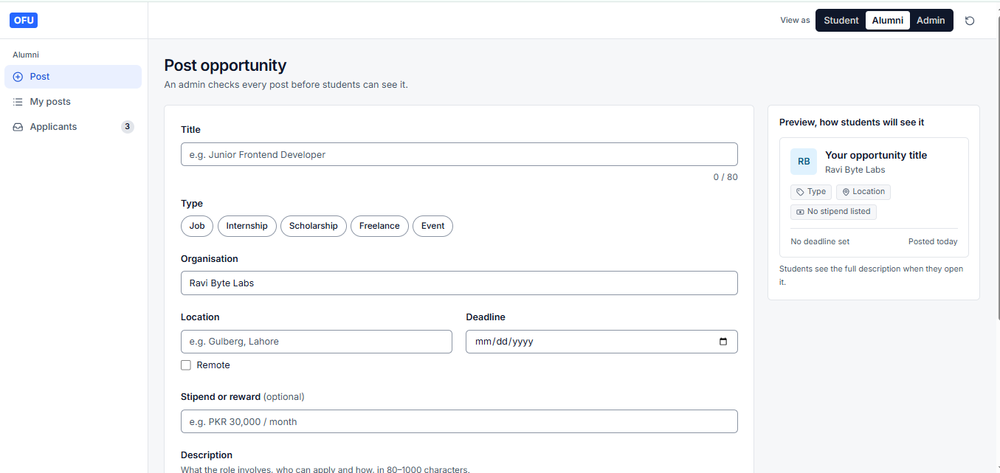
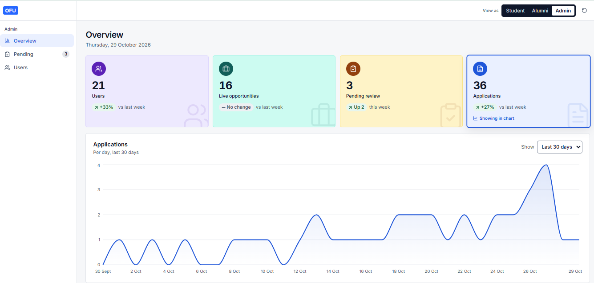
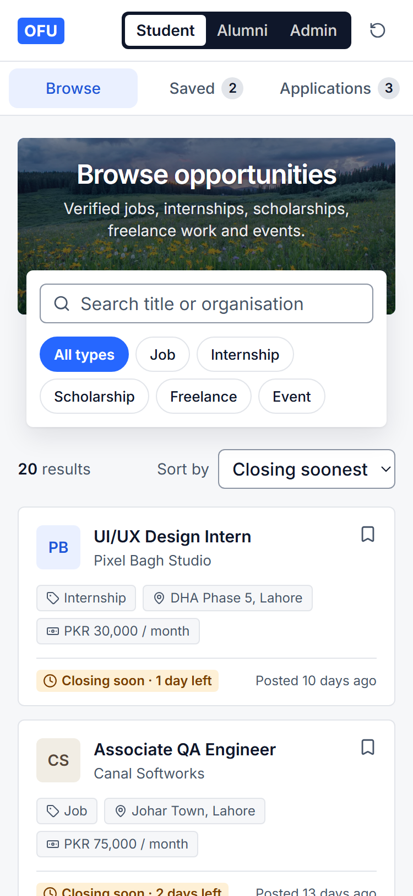

# OFU

Every career opportunity, in one place.

**Live demo:** [ofu-ucp.vercel.app](https://ofu-ucp.vercel.app)



## About

At university, opportunities are scattered across WhatsApp groups, forwarded emails and notice boards, so students often hear about an internship or scholarship after the deadline has passed. OFU (Opportunities for UCPians) puts them in one verified place: alumni and employers post opportunities, an admin checks every post, and students browse, save and apply before the deadline.

This is my solo frontend redesign of OFU, the final year project my team of four built at the University of Central Punjab. The original was a full-stack app; this version is a new design and a new React codebase. It runs entirely in the browser with fictional demo data saved in localStorage, and has no backend.

## Try it in 30 seconds

Open the [live demo](https://ofu-ucp.vercel.app) and click **Try the demo**. Use **View as** in the top bar to switch between Student, Alumni and Admin at any time. There is no login.

All three roles share the same data, so you can follow one opportunity through the whole flow:

1. **Alumni posts.** View as Alumni, fill in Post opportunity and submit. It is saved as Pending.
2. **Admin approves.** View as Admin, open Pending approvals and approve the new post.
3. **Student applies.** View as Student, find the post in Browse, open it and apply with a short cover note.
4. **Alumni accepts.** View as Alumni, open Applicants and accept the application.
5. **Student sees Accepted.** View as Student and open My applications: the status now reads Accepted.

The reset button next to View as restores the original demo data.

## Features by role

The landing page includes a tour that switches between a live preview of each role's main page.



### Student

- Browse approved opportunities with search, type filters and sorting by closing date or newest
- Deadline status on every card: Open, Closing soon (3 days or less) or Closed, in text as well as colour
- Opportunity page with a deadline countdown, copy link and save
- Apply with a short cover note; closed opportunities explain why Apply is disabled
- Saved list and My applications with Submitted, Accepted and Rejected statuses





### Alumni

- Post an opportunity with a live preview of the card students will see
- My posts with Pending, Approved and Rejected statuses, the admin's reason for a rejection, and fix and resubmit
- Applicants grouped by post, with Accept and Reject that update the student's application



### Admin

- Overview with stat cards that switch an activity chart between the last 7 and 30 days, opportunities by type and the oldest posts waiting for review
- Pending approvals one post at a time, with automatic checks, a student preview and an optional reject reason
- Users list with search, role filter and an activate or deactivate switch



## Frontend details

- Accessible dialogs that trap focus, close on Escape and return focus to the button that opened them
- Inline form validation on blur, with errors that clear as soon as a field is fixed and focus on the first invalid field
- Toasts that stack, pause on hover and offer Undo for reversible actions
- Skeleton loaders shaped like the real content, so nothing jumps when data appears
- Empty states with one helpful line and one action
- Search, type and sort filters synced to the URL, so they survive a refresh and can be shared
- Responsive layouts down to 375px: the sidebar becomes a top nav and tables become cards
- Keyboard support with visible focus rings, and WCAG AA contrast for text and controls
- Charts loaded lazily, so the chart library only downloads when the Admin overview opens



## Tech stack

- React and Vite, written in JavaScript
- Tailwind CSS
- React Router
- React Context with useReducer for state, persisted to localStorage
- Recharts for the Admin charts
- lucide-react for icons
- Deployed on Vercel

## Project structure

```
src/
  components/   reusable UI, split into admin, charts, landing, layout, opportunity and ui
  data/         fictional seed data for opportunities, users and applications
  hooks/        small shared hooks, such as reduced motion and saving
  pages/        one folder per role: public, student, alumni and admin
  store/        app state with Context and useReducer, toasts and localStorage
  utils/        dates, filters, validation and stats helpers
```

## Run locally

You need Node.js 20.19 or later.

```bash
git clone https://github.com/Awaisalpha/ofu.git
cd ofu
npm install
npm run dev
```

Then open the address Vite prints, usually http://localhost:5173.

## Future work

- A real backend with user accounts and authentication
- The AI resume analyzer and chatbot from the original final year project
- Notifications when a saved opportunity is about to close

## Author

**Awais Ahmed Khan**

- GitHub: [Awaisalpha](https://github.com/Awaisalpha)
- LinkedIn: [Awais Ahmed](https://www.linkedin.com/in/awais-ahmed-506195219/)
